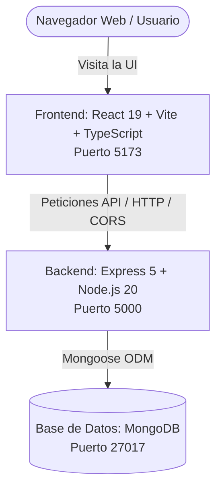

# 🪟 Windows XP Clone — Full Stack Web Application

> **Una recreación fiel, nostálgica y moderna del legendario sistema operativo Windows XP (Luna Blue) para la web.**

Este proyecto es un monorepo / arquitectura multi-servicio que emula la experiencia visual y funcional de **Windows XP**. Combina un cliente interactivo construido con **React 19**, **TypeScript** y **Vite**, un backend API con **Node.js**, **Express 5** y **MongoDB**, todo orquestado mediante **Docker & Docker Compose** para un despliegue y desarrollo inmediato con un solo comando.

---

## 📑 Tabla de Contenidos

- [✨ Características Principales](#-características-principales)
- [🏗️ Arquitectura del Proyecto](#️-arquitectura-del-proyecto)
- [🚀 Tecnologías Utilizadas](#-tecnologías-utilizadas)
- [📁 Estructura del Repositorio](#-estructura-del-repositorio)
- [🔌 Puertos y Servicios](#-puertos-y-servicios)
- [🛠️ Requisitos Previos](#️-requisitos-previos)
- [🏃 ¿Cómo Ejecutar Todo el Proyecto?](#-cómo-ejecutar-todo-el-proyecto)
  - [Método 1: Ejecutar con Docker Compose (Recomendado)](#método-1-ejecutar-con-docker-compose-recomendado)
  - [Método 2: Ejecutar en Local (Sin Docker)](#método-2-ejecutar-en-local-sin-docker)
- [📜 Scripts Disponibles](#-scripts-disponibles)
- [⚙️ Variables de Entorno](#️-variables-de-entorno)
- [🔧 Solución de Problemas Frecuentes (FAQ)](#-solución-de-problemas-frecuentes-faq)
- [🗺️ Estado Actual y Roadmap](#️-estado-actual-y-roadmap)

---

## ✨ Características Principales

- **Diseño clásico Luna Blue:** Recreación de los gradientes, bordes biselados, tipografía Tahoma y sombras nativas de Windows XP.
- **Fondo de Pantalla Bliss:** Integración del icónico fondo de colinas verdes en alta resolución.
- **Barra de Tareas & Botón Inicio:** Botón curvo verde característico con logo tricolor de Windows y estados interactivos (*hover* y *active*).
- **Calculadora Clásica de Windows XP:** Réplica interactiva con diseño Luna Blue idéntico, soporte para operaciones matemáticas completas, raíz cuadrada (`sqrt`), recíproco (`1/x`), porcentaje (`%`), memoria (`MC`, `MR`, `MS`, `M+`), atajos de teclado y ventana arrastrable.
- **MS Paint Interactivo de Windows XP:** Réplica de Paint con caja de 16 herramientas clásicas (lápiz, pinceles personalizables, bote de relleno/cubo con algoritmo flood-fill, formas geométricas con modos de relleno, borrador por tamaño, gotero selector de color, herramienta de texto con barra flotante y lupa con niveles de zoom), paleta de 28 colores de Windows XP, soporte para deshacer/rehacer (`Ctrl+Z`/`Ctrl+Y`), descarga de imágenes (`PNG`) y carga de archivos locales.
- **Juego Clásico de Buscaminas (Minesweeper):** Réplica 100% auténtica del Buscaminas de Windows XP con bordes biselados 3D, display digital LED de 7 segmentos en rojo para minas restantes y cronómetro (000-999), botón con carita sonriente reactiva (normal 🙂, asustada 😮 al pulsar casillas, lentes de sol 😎 al ganar, ojos de cruz 😵 al perder), soporte para dificultades (Principiante 9x9, Intermedio 16x16, Experto 30x16 y Personalizado), banderas, signos de interrogación (marcas `?`), acción de chording (doble clic), primer clic seguro garantizado, efectos de sonido retro sintetizados vía Web Audio API y tabla de mejores tiempos guardada en LocalStorage.
- **Backend Conectado a Base de Datos:** Servidor Express preparado para gestionar persistencia de datos (usuarios, configuraciones, archivos virtuales) con MongoDB.
- **Hot Reloading & Sincronización en Contenedores:** Scripts de entrada (`entrypoint.sh`) que sincronizan dependencias y permiten editar código en caliente sin reconstruir imágenes.

---

## 🏗️ Arquitectura del Proyecto

El sistema se compone de tres servicios coordinados:



1. **Frontend (`/client`):** Single Page Application (SPA) encargada de renderizar el escritorio, ventanas, barra de tareas y aplicaciones simuladas.
2. **Backend (`/server`):** API REST que expone endpoints para persistencia, autenticación o configuración de estado.
3. **Database (`db`):** Contenedor oficial de MongoDB con volumen persistente (`mongo-data`) para conservar los datos entre reinicios.

---

## 🚀 Tecnologías Utilizadas

### 🖥️ Frontend (Cliente)
| Tecnología | Versión | Uso en el Proyecto |
| :--- | :--- | :--- |
| **React** | `^19.1.1` | Librería principal para la interfaz de usuario basada en componentes |
| **TypeScript** | `~5.9.3` | Tipado estático estricto y autocompletado |
| **Vite** | `^7.1.7` | Servidor de desarrollo ultrarrápido con HMR y empaquetador |
| **Styled Components** | `^6.1.19` | CSS-in-JS para recrear los temas y estilos de Windows XP |
| **React Icons** | `^5.5.0` | Iconografía vectorial (ej. logo de Windows en el botón Start) |
| **Yarn (Berry)** | `^4.9.2` | Gestor de paquetes con `nodeLinker: node-modules` |

### ⚙️ Backend (Servidor)
| Tecnología | Versión | Uso en el Proyecto |
| :--- | :--- | :--- |
| **Node.js** | `>= 20.x` | Entorno de ejecución en servidor |
| **Express** | `^5.1.0` | Framework web para rutas y endpoints REST |
| **MongoDB & Mongoose** | `^8.19.2` | Base de datos NoSQL y ODM de modelado |
| **CORS** | `^2.8.5` | Habilitación de peticiones cruzadas desde el frontend |
| **Nodemon** | `^3.1.10` | Recarga automática del servidor al detectar cambios en el código |

### 🐳 DevOps y Contenedores
| Herramienta | Versión / Detalle | Función |
| :--- | :--- | :--- |
| **Docker** | `v20+` / Multi-stage | Contenedorización de client y server |
| **Docker Compose** | `v3.8+` | Orquestación unificada de los 3 servicios (`client`, `server`, `db`) |

---

## 📁 Estructura del Repositorio

```plaintext
windows-xp-clone/
├── docker-compose.yml          # Orquestador de servicios (client, server, db)
├── README.md                   # Documentación general del proyecto (este archivo)
│
├── client/                     # Código fuente del Frontend (React + Vite)
│   ├── public/                 # Archivos estáticos públicos
│   ├── src/                    # Código fuente de la interfaz
│   │   ├── assets/             # Wallpapers (xp-wallpaper.jpg), iconos, sonidos
│   │   ├── components/         # Componentes UI (Taskbar, StartButton, etc.)
│   │   ├── App.tsx             # Componente raíz del escritorio
│   │   ├── GlobalStyle.ts      # Estilos globales (fuente Tahoma, fondo Bliss)
│   │   ├── index.css           # Estilos base
│   │   └── main.tsx            # Punto de entrada de React en el DOM
│   ├── Dockerfile              # Configuración de Docker para el cliente
│   ├── entrypoint.sh           # Script de inicio y sincronización de Yarn
│   ├── package.json            # Dependencias y scripts del cliente
│   ├── tsconfig.json           # Configuración de TypeScript
│   ├── vite.config.ts          # Configuración de Vite
│   └── README.md               # Documentación específica del cliente
│
└── server/                     # Código fuente del Backend (Express + MongoDB)
    ├── Dockerfile              # Configuración de Docker para el servidor
    ├── entrypoint.sh           # Script de inicio y sincronización de dependencias
    ├── index.js                # Entrada de la API, conexión a MongoDB y rutas
    ├── package.json            # Dependencias y scripts del servidor
    └── README.md               # Documentación específica del servidor
```

---

## 🔌 Puertos y Servicios

Cuando el proyecto está levantado, los servicios quedan mapeados en los siguientes puertos:

| Servicio | Puerto Local | Descripción | URL de Acceso |
| :--- | :---: | :--- | :--- |
| **Cliente Web** | `5173` | Aplicación visual de Windows XP | [http://localhost:5173](http://localhost:5173) |
| **Backend API** | `5000` | API REST del servidor | [http://localhost:5000](http://localhost:5000) |
| **MongoDB** | `27017` | Instancia de base de datos | `mongodb://localhost:27017` |

> 💡 **Prueba rápida de la API:** Acceder a [http://localhost:5000/](http://localhost:5000/) retornará:
> ```json
> { "message": "¡Bienvenido a la API de Windows XP Clone!" }
> ```

---

## 🛠️ Requisitos Previos

Dependiendo del método de ejecución elegido:

### Para el Método 1 (Docker Compose - Recomendado):
- [Docker Desktop](https://www.docker.com/products/docker-desktop/) instalado y en ejecución en tu equipo.

### Para el Método 2 (Local sin Docker):
- [Node.js](https://nodejs.org/) v20 o superior.
- [Yarn](https://yarnpkg.com/) habilitado mediante Corepack:
  ```bash
  corepack enable
  ```
- [MongoDB Community Server](https://www.mongodb.com/try/download/community) corriendo localmente en el puerto `27017` (o una instancia de MongoDB Atlas).

---

## 🏃 ¿Cómo Ejecutar Todo el Proyecto?

### Método 1: Ejecutar con Docker Compose (Recomendado)

Este método levanta **todo el stack** (Frontend, Backend y Base de Datos) con un único comando:

1. **Abrir una terminal en la raíz del proyecto:**
   ```bash
   cd d:/ProyectosWEB/windows-xp-clone
   ```

2. **Construir y levantar todos los contenedores:**
   ```bash
   docker compose up --build
   ```
   *(Si prefieres ejecutarlo en segundo plano, añade `-d`: `docker compose up -d --build`)*

3. **Verificar que todo esté corriendo:**
   - **Frontend:** Abre tu navegador en [http://localhost:5173](http://localhost:5173).
   - **Backend API:** Abre [http://localhost:5000](http://localhost:5000).
   - **MongoDB:** Estará listo recibiendo conexiones en el puerto `27017`.

4. **Para detener los servicios:**
   - Si está en primer plano: Presiona `Ctrl + C`.
   - Si está en segundo plano o para limpiar contenedores:
     ```bash
     docker compose down
     ```

> 🌟 **Ventaja del `entrypoint.sh`:**  
> Los archivos de código están montados como volúmenes (`./client:/app` y `./server:/app`). Cualquier cambio que hagas en tu editor se reflejará al instante gracias al HMR de Vite y Nodemon, sin necesidad de reiniciar Docker.

---

### Método 2: Ejecutar en Local (Sin Docker)

Si prefieres correr los servicios directamente en tu sistema operativo, sigue estos pasos:

#### Paso 1: Levantar la Base de Datos MongoDB
Asegúrate de que tu servicio local de MongoDB esté activo en el puerto `27017`.  
*(Opcional: puedes levantar solo MongoDB con Docker si lo prefieres)*:
```bash
docker run -d -p 27017:27017 --name mongo-xp mongo:latest
```

#### Paso 2: Iniciar el Servidor Backend
Abre una terminal y ejecuta:
```bash
cd server

# 1. Habilitar Yarn e instalar dependencias
corepack enable
yarn install

# 2. Configurar variable de entorno para MongoDB
# En Windows (PowerShell):
$env:MONGO_URL="mongodb://localhost:27017/windowsxp"
$env:PORT="5000"

# En Linux/macOS o Git Bash:
export MONGO_URL="mongodb://localhost:27017/windowsxp"
export PORT=5000

# 3. Iniciar el servidor en modo desarrollo
yarn dev
```
Verás en consola:
```text
✅ Conectado a MongoDB
🚀 Servidor corriendo en el puerto 5000
```

#### Paso 3: Iniciar el Cliente Frontend
Abre **otra terminal** y ejecuta:
```bash
cd client

# 1. Instalar dependencias
corepack enable
yarn install

# 2. Iniciar el servidor de desarrollo de Vite
yarn dev
```
El cliente se iniciará en [http://localhost:5173](http://localhost:5173).

---

## 📜 Scripts Disponibles

### En el Cliente (`client/`):
| Script | Comando | Descripción |
| :--- | :--- | :--- |
| `dev` | `yarn dev` | Inicia el servidor de desarrollo con Vite en `http://localhost:5173` |
| `build` | `yarn build` | Compila TypeScript (`tsc -b`) y genera el bundle optimizado para producción |
| `lint` | `yarn lint` | Analiza el código con ESLint en busca de errores de sintaxis y buenas prácticas |
| `preview` | `yarn preview` | Previsualiza localmente el bundle generado en producción |

### En el Servidor (`server/`):
| Script | Comando | Descripción |
| :--- | :--- | :--- |
| `dev` | `yarn dev` | Inicia el backend con `nodemon` para reinicio automático ante cambios |
| `start` | `yarn start` | Inicia el servidor estándar con `node index.js` |

---

## ⚙️ Variables de Entorno

### Servidor (`server/`)
| Variable | Por Defecto | Descripción |
| :--- | :---: | :--- |
| `PORT` | `5000` | Puerto en el que escucha el servidor Express |
| `MONGO_URL` | *(Requerido)* | Cadena de conexión hacia MongoDB (`mongodb://db:27017/windowsxp` en Docker Compose o `mongodb://localhost:27017/windowsxp` en local) |

> ⚠️ Si `MONGO_URL` no está definida o la base de datos no responde, el servidor mostrará `❌ Error al conectar a MongoDB` y se detendrá preventivamente.

---

## 🔧 Solución de Problemas Frecuentes (FAQ)

### 1. `Error al conectar a MongoDB: connect ECONNREFUSED`
- **Causa:** El servidor intentó arrancar antes de que MongoDB estuviera listo o la URI es incorrecta.
- **Solución en Docker:** Docker Compose tiene configurado `depends_on: - db`. Si es la primera vez que se descarga la imagen de Mongo, simplemente reinicia con `docker compose up`.
- **Solución en Local:** Asegúrate de que el servicio `mongod` esté corriendo en tu máquina antes de ejecutar `yarn dev` en el servidor.

### 2. Conflicto con Yarn Berry (`corepack`)
Si tu terminal no reconoce `yarn` o muestra error de versión:
```bash
corepack enable
yarn set version berry
yarn config set nodeLinker node-modules
yarn install
```

### 3. Error de permisos en `entrypoint.sh` en Linux / Mac / WSL
Si Docker reporta `permission denied: /entrypoint.sh`:
```bash
git update-index --chmod=+x client/entrypoint.sh
git update-index --chmod=+x server/entrypoint.sh
```

### 4. Reiniciar Docker desde cero (limpieza de volúmenes)
Si modificaste paquetes o quieres reconstruir todo el caché:
```bash
docker compose down -v
docker compose build --no-cache
docker compose up
```

---

## 🗺️ Estado Actual y Roadmap

- [x] Arquitectura de microservicios con Docker Compose.
- [x] Sincronización automática de dependencias mediante `entrypoint.sh`.
- [x] Configuración de MongoDB y Express 5 con conexión validada.
- [x] Fondo de pantalla clásico *Bliss* (`xp-wallpaper.jpg`).
- [x] Barra de tareas inferior (*Taskbar*) con gradiente azul Luna.
- [x] Botón Inicio (*Start Button*) con curvatura, logo vectorial y estados interactivos.
- [x] Reloj digital y bandeja del sistema (*System Tray*).
- [x] Menú de inicio emergente (*Start Menu*) con lista de programas y accesos directos.
- [x] Iconos interactivos en el escritorio (Mi PC, Papelera de reciclaje, Mis documentos, Calculadora, Paint, Buscaminas).
- [x] Sistema de ventanas flotantes, minimizables, maximizables y arrastrables (*Draggable Windows*).
- [x] Aplicaciones clásicas completadas: Calculadora, Paint y Buscaminas (Minesweeper).

---

⭐ *Desarrollado con pasión para revivir la era dorada de la informática personal.*
